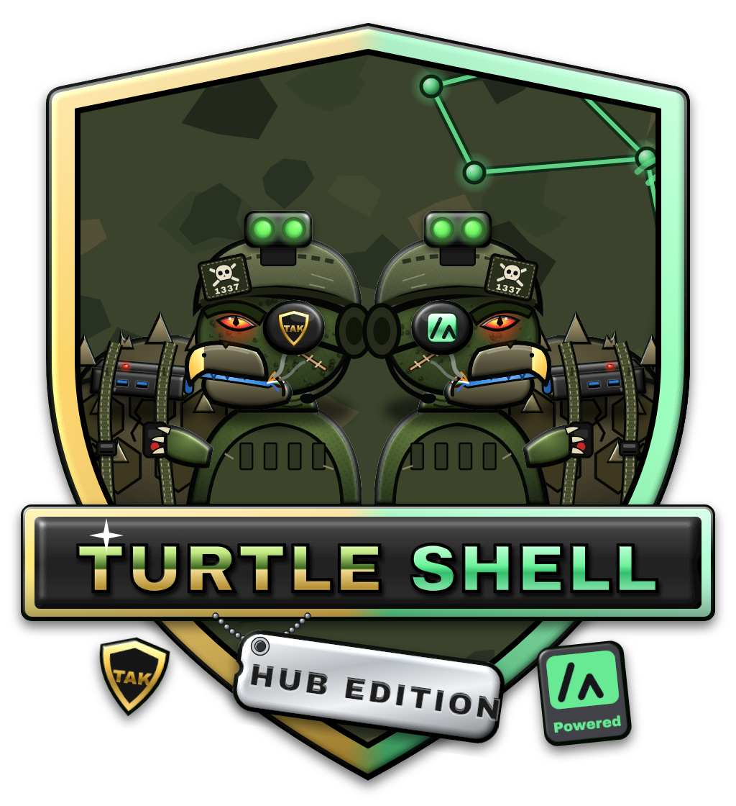

# TurtleShell – TAK and Meshtastic payloads for the Hak5 [LAN Turtle](https://hak5.org/products/lan-turtle-hub)

<p align="center"></p>

[](https://www.buymeacoffee.com/sect0101)

The LAN Turtle Hub runs one payload at a time. **TurtleShell** is one payload that runs both [TurtleTAK](https://github.com/SECT0101/TurtleTAK) and [TurtleMesh](https://github.com/SECT0101/TurtleMesh) on the same Hub, so it is a sensor on the **TAK** map and a **Meshtastic** node at once.

**Payloads here are written in Bash + Python for the LAN Turtle Hub. They are community payloads and are not supported or guaranteed by Hak5.** See [Legal](#legal).

Need only one of them? Use [TurtleTAK](https://github.com/SECT0101/TurtleTAK) or [TurtleMesh](https://github.com/SECT0101/TurtleMesh) on its own. Also see [TurtleTAK Classic](https://github.com/SECT0101/TurtleTAK-Classic) for the original LAN Turtle and LAN Turtle SD, [PagerTAK](https://github.com/SECT0101/PagerTAK) for the WiFi Pineapple Pager and [PagerMesh](https://github.com/SECT0101/PagerMesh) for Meshtastic on the Pager.

---

## Payloads

| Edition | Device | Version | Description |
|---|---|---|---|
| [TurtleShell Hub Edition](payloads/library/general/TurtleShell-Hub/) | LAN Turtle Hub | 1.0.1 | TurtleTAK 1.0.2 and TurtleMesh 1.0.2 from one payload. TurtleTAK puts the Hub on TAK as a facility sensor with network watch alerts (web console on port 8484). TurtleMesh runs a Meshtastic radio with mesh chat, nodes, mesh watch and sensor alerts and a mesh ↔ TAK bridge (port 8485). Together: one TAK setup for both, TurtleTAK's alerts over LoRa, the radio's GPS as the Hub's position, consoles that link to each other, and a watchdog that restarts either service if it stops. |

## Repository layout

```
payloads/
└── library/
    └── general/
        └── TurtleShell-Hub/
            ├── payload.sh      # the whole payload: TurtleTAK and TurtleMesh inside, plus the launcher and watchdog
            └── README.md       # setup, how the two work together, LED, files
docs/
├── logo.png                    # TurtleShell Hub Edition
└── web-*.jpg                   # the two web consoles (demo data)
.github/
├── FUNDING.yml                 # Buy Me a Coffee (Sponsor button)
└── workflows/                  # shellcheck on every push; payload.sh attached to every release
```

Settings, certificates and logs live on the Hub under `/root/turtletak/` and `/root/turtlemesh/`, the same folders the single payloads use, so you can switch between TurtleShell and either single payload without setting anything up again.

## Requirements

- LAN Turtle Hub with Python 3 (no openssl needed)
- A TAK Server, plus a client certificate for TLS (or enroll on the Hub with a TAK username)
- A Meshtastic radio on the same network (Wi-Fi), or on the Hub's dynamic USB port (native-USB radios such as the Heltec Wireless Tracker)

## Legal

Use these payloads only on networks and radio channels you own or are authorized to use, and follow your local radio rules. You are responsible for complying with all applicable laws and policies. Meshtastic® is a registered trademark of Meshtastic LLC. This project is not affiliated with or endorsed by Meshtastic, Hak5 or the TAK Product Center.

## License

[GPL-3.0](LICENSE). Leaflet is bundled under BSD-2-Clause; see [THIRD-PARTY-LICENSES.txt](THIRD-PARTY-LICENSES.txt).
